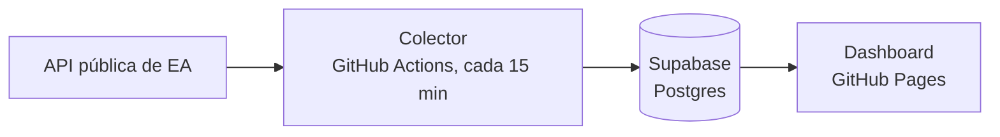

# Stats de Clubes · EA SPORTS FC

Estadísticas de nuestro club de Clubes (Pro Clubs) de EA SPORTS FC, por partido y en total. Se capturan solas desde la web pública de EA y se muestran en un dashboard para todo el equipo.

**Dashboard:** https://pinedas.github.io/proclubs-stats/



- **100 % automático:** nadie carga datos a mano y no depende de ninguna PC.
- **Costo cero:** GitHub Free (repo público), Supabase Free y GitHub Pages.
- **No se pierde ningún dato:** se guarda el JSON completo de todo lo que da EA, aunque el dashboard muestre solo lo importante.

## Documentación

| Para | Documento |
|---|---|
| El equipo: qué muestra cada pestaña y cómo leerlo | [docs/manual-de-usuario.md](docs/manual-de-usuario.md) |
| Desarrollo: arquitectura, modelo de datos, seguridad y diagramas | [docs/arquitectura.md](docs/arquitectura.md) |
| Qué datos da EA y cuáles se usan | [docs/datos-ea.md](docs/datos-ea.md) |
| Cambiar de club o de juego (FC 28) | [docs/cambio-de-temporada.md](docs/cambio-de-temporada.md) |
| Decisiones tomadas y pendientes | [CLAUDE.md](CLAUDE.md) |

## Estructura

```
collector/   Colector en Node.js 22 + TypeScript (proclubs-sdk)
supabase/    Migraciones SQL y pruebas del esquema
dashboard/   Web estática (HTML, CSS y JS sin dependencias)
docs/        Documentación
.github/     Workflows: colector, dashboard, CI, respaldos y detección de cambios de EA
```

No es un producto oficial de EA. Usa los endpoints públicos que lee la web de Clubes.
