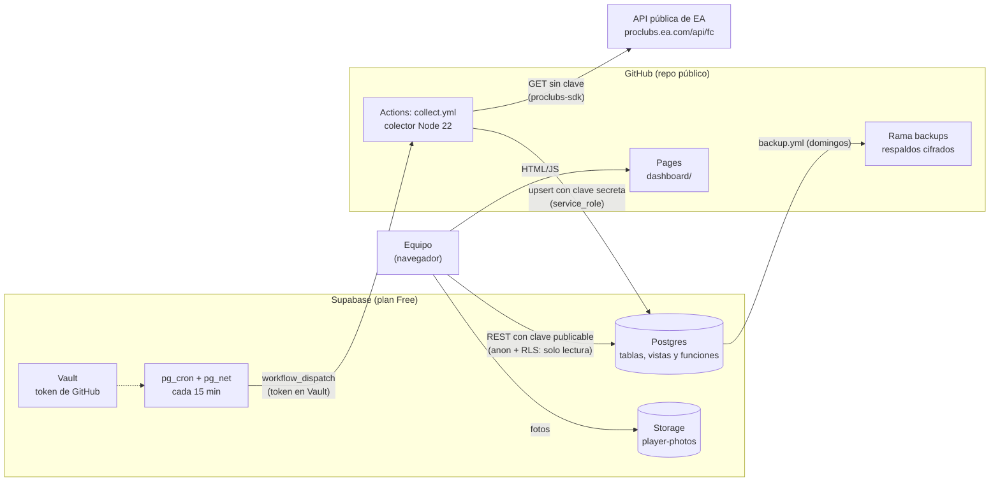
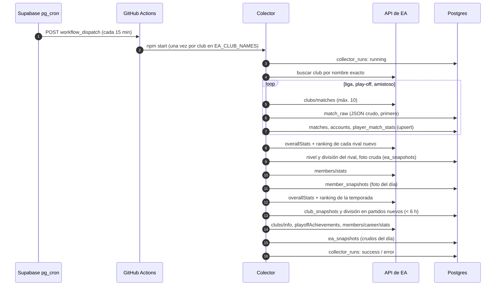
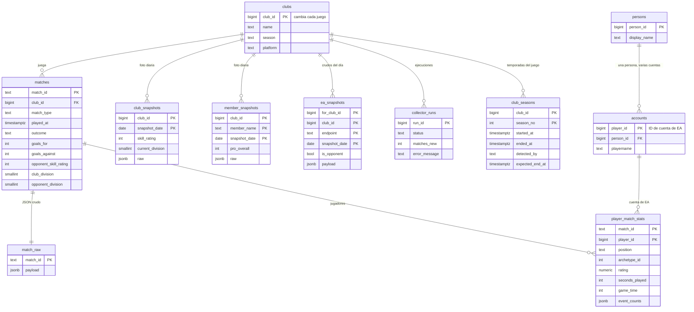
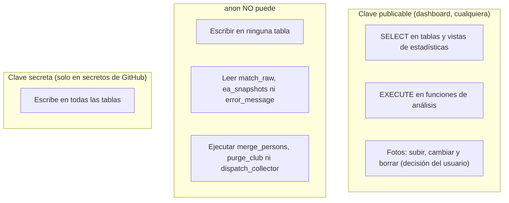
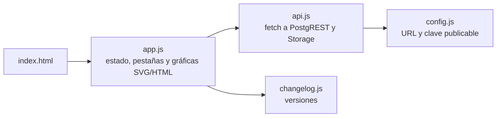

# Documentación técnica

Sistema 100 % automático y gratuito: captura las estadísticas de un club de Clubes (Pro Clubs) de EA SPORTS FC, las guarda en Postgres y las muestra en una web estática.

- **Para el equipo:** [manual-de-usuario.md](manual-de-usuario.md).
- **Datos que da EA:** [datos-ea.md](datos-ea.md).
- **Cambio de club o de juego:** [cambio-de-temporada.md](cambio-de-temporada.md).
- **Decisiones y contexto:** [CLAUDE.md](../CLAUDE.md).

## 1. Vista general



**Por qué así:**
- **Postgres** y no archivos JSON: por la flexibilidad del SQL y para poder tener varias temporadas y clubes.
- **Disparo desde Supabase:** el cron de GitHub resultó poco confiable (1 de unas 25 ejecuciones el 2026-11-11). El cron de `collect.yml` (minutos 7 y 37) queda como respaldo.
- **Dashboard sin compilar ni dependencias:** HTML, CSS y JS nativos. No hay CDN ni paso de compilación que pueda romperse.
- **Costo cero:** solo planes gratuitos. Ver CLAUDE.md §2.

## 2. Una ejecución del colector



**Reglas:**
- **Idempotente:** todo es *upsert* (insertar o actualizar) por llave natural. Correr dos veces, o en la nube y en casa a la vez, no duplica nada.
- **El crudo va primero:** `match_raw` se guarda antes de normalizar. Si la transformación falla, el partido no se pierde y se puede reprocesar.
- **Fallas:**
  - Si EA falla en un tipo de partido, se registra y se siguen los demás.
  - Si falla la base de datos, se aborta.
  - Cualquier falla deja la ejecución en `error` y el proceso sale con código ≠ 0. GitHub manda un correo y, si existe el secreto `DISCORD_WEBHOOK_URL`, también un aviso a Discord desde la 3.ª falla seguida.
- **Datos complementarios** (nivel y división del rival, clubs/info, play-off, carrera): una falla de EA solo se anota en el log.
- **Divisiones:** la propia y la del rival se anotan solo en partidos nuevos de menos de 6 h. Un partido más viejo pudo jugarse en otra división.

### Código del colector (`collector/src`)

| Archivo | Responsabilidad |
|---|---|
| `main.ts` | Entrada: lee la configuración y ejecuta `collect()` por cada club. |
| `config.ts` | Variables de entorno validadas con Zod. |
| `ea-source.ts` | `MatchSource`: interfaz hacia EA (`proclubs-sdk`). Se reemplaza por un doble en los tests. |
| `collect.ts` | Orquestación de una ejecución (inyección de dependencias). |
| `transform.ts` | Transformación **pura** de partido crudo a filas. Probada con un JSON real anonimizado. |
| `club.ts`, `members.ts` | Fotos diarias del club y de los miembros. |
| `repository.ts` | `StatsRepository` (patrón Repository) sobre Supabase. |
| `backup.ts` | Exporta las tablas y genera el SQL de restauración. |
| `alerts.ts` | Cuándo avisar a Discord. |

## 3. Modelo de datos



- **Identidad:** la llave de un jugador es su `player_id` de EA, porque el nombre puede cambiar. Una **persona** agrupa varias cuentas: alguien que juega en PC y en PS5 se une con `merge_persons()`. Los rankings son por persona.
- **No se pierde nada:** el JSON completo se guarda en `match_raw.payload`, `club_snapshots.raw`, `member_snapshots.raw` y `ea_snapshots.payload`. Los contadores sin documentar de EA (`match_event_aggregate_*`) se guardan todos en `player_match_stats.event_counts`.
- **Experimentales:** se calculan en la vista `v_player_match_stats` con `event_sum(event_counts, códigos)`, con sufijo `_exp`. Los códigos y su contraste con datos oficiales están en `datos-ea.md`.
- **Juego y temporada:** `clubs.season` es el juego (FC27) y `club_seasons` guarda las temporadas dentro de él.
  - EA no da el número ni las fechas. El colector (`seasons.ts`) abre una temporada nueva cuando bajan los partidos de `currentSeason` y no suben los puntos.
  - El dashboard filtra una temporada por su rango de fechas, con los mismos `p_from`/`p_to` de todas las funciones.
- **Escudo:** `clubs.crest_asset_id` y `team_id` salen de `currentSeason.clubInfo`. La imagen y los íconos de división se cargan de las direcciones públicas de EA que documenta la comunidad.
- **Valores de EA tal cual:** la división se guarda con el número de EA; el dashboard muestra uno menos, como el juego. La calificación media y el % MVP son los de EA, sin ponderar.

### Funciones de análisis (RPC que lee el dashboard)

Todas reciben los mismos filtros: tipos de partido, fechas, club y excluir abandonos.

| Función o vista | Para qué |
|---|---|
| `v_player_match_stats` | Un jugador en un partido, con contexto (división, nivel del rival, abandono, experimentales). |
| `person_stats` | Totales y tasas por persona (Ranking). |
| `relative_stats`, `relative_stats_detail` | Índices relativos a la posición: 100 = promedio de la posición o arquetipo. |
| `person_split_stats` | Comparar: rival fuerte/débil, tipo, jugadores en cancha, división. |
| `position_stats`, `position_fit` | Valores por posición y posición recomendada. |
| `person_records` | Récords y rachas. |
| `v_member_latest`, `v_reconciliation` | Última foto de members/stats y conciliación EA vs. capturado. |
| `dispatch_status()` | Estado del disparo desde Supabase (sin exponer el token). |

`pair_stats` y `with_without_stats` siguen en la base, pero desde la v2.7 la pestaña Duplas se calcula en el navegador a partir de `v_player_match_stats`.

## 4. Seguridad



- **RLS** (seguridad a nivel de fila) en todas las tablas, con permisos explícitos (migración 004): las tablas nuevas no quedan expuestas solas.
- **XSS:** el dashboard inserta todo texto de EA como texto, nunca como HTML (`el()` en `app.js`).
- **Secretos:** `SUPABASE_SERVICE_ROLE_KEY`, `BACKUP_PASSPHRASE`, el token de GitHub (en Vault) y `DISCORD_WEBHOOK_URL` (opcional). Nunca van en el repo, que es público.
- **Respaldos:** cifrados con AES-256 antes de publicarse en la rama `backups`. Se conservan los últimos 12.
- **Datos de terceros:** los fixtures de prueba se anonimizan (`scripts/anonymize.ts`).

## 5. Dashboard (`dashboard/`)



- **Estado:** un objeto `state`. Cada cambio de filtro llama a `refresh()`, que pide en paralelo `person_stats`, `person_records`, `relative_stats`, la línea de tiempo y las fotos, y dibuja la pestaña activa. `requestId` descarta respuestas viejas.
- **Columnas del ranking:** `RANKING_COLUMNS` define cada dato con:
  - `kind`: `base`, `abs` (total) o `rate` (proporción);
  - `exp`: experimental;
  - `important`: visible por defecto;
  - `better`: `high`, `low` o `null`.

  Los botones "Datos" y "+ Añadir dato" filtran sobre eso. Lo agregado a mano se guarda en `localStorage`.
- **Calculado en el navegador** con la línea de tiempo (`getRatingsTimeline`):
  - posiciones por minutos;
  - por 90 min de los experimentales;
  - promedio del equipo;
  - Duplas;
  - resultados por semana.
- **Datos parciales:** `coverage()` mide en cuántos partidos existe un dato. Por debajo del 50 % la columna no se muestra; si falta en algunos, lleva la etiqueta "Parcial".
- **Gráficas:** SVG o HTML propios, sin librerías. Usan un color por serie; para dos series, el par azul y naranja validado para daltonismo (`--pa`, `--pb`). Siempre llevan texto o leyenda además del color.
- **Caché:** `pages.yml` reemplaza `__V__` por el commit en cada publicación, para no mezclar archivos viejos y nuevos.
- **Versiones:** al publicar un cambio visible, agregar una entrada arriba en `changelog.js`, con la fecha de Colombia.

## 6. Workflows de GitHub Actions

| Workflow | Cuándo | Qué hace |
|---|---|---|
| `collect.yml` | Disparo desde Supabase cada 15 min; cron de respaldo | Ejecuta el colector, avisa a Discord si falla seguido y mantiene activo el cron. |
| `pages.yml` | Cada push a `main` | Publica `dashboard/` en GitHub Pages. |
| `ci.yml` | Cada push y PR | Tipos y tests unitarios; migraciones y pruebas SQL en Postgres 17 (Docker); integración colector → PostgREST → Postgres; prueba de restauración; sintaxis del dashboard. |
| `backup.yml` | Domingos | Exporta, comprime, cifra y publica en la rama `backups`. |
| `ea-drift.yml` | Lunes | Compara las respuestas reales de EA con los contratos del SDK, para detectar cambios de la API. |

## 7. Pruebas y desarrollo local

```bash
cd collector && npm ci
```

```bash
npm run typecheck && npm test
```

```bash
bash supabase/tests/run_tests.sh
```

```bash
npm run test:integration
```

- `npm test`: tests unitarios con dobles de EA y de la base.
- `run_tests.sh`: migraciones y pruebas SQL en un Postgres desechable (Docker).
- `test:integration`: el colector contra Postgres y PostgREST reales en Docker.

**Para aplicar una migración nueva:** súbela al repo, ábrela en el SQL Editor de Supabase, ejecútala y verifica el resultado con consultas al catálogo. Todas las migraciones aplicadas están en `supabase/migrations` (001–021).
